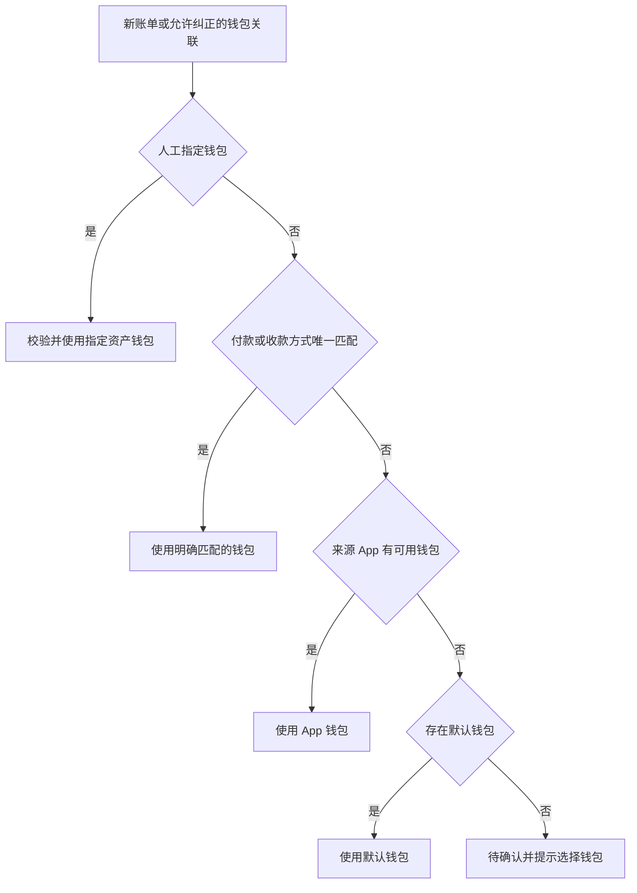

# 账单钱包余额联动与摇一摇白名单开发说明

面向接手开发的 6.1sol。目标是在现有 Android 本地记账链路中完成钱包余额联动，并将摇一摇采集限制在用户主动选择的应用内。本文定义业务规则、数据模型、接入位置、迁移策略和验收条件，可直接作为开发任务输入。

文档日期：2026-11-05。源码基线：`abb796d829748403612f09e89909819b974565c7`，应用版本 `0.5.88-v6`，账本数据库版本 `8`。开始开发时以实际分支为准，先核对基线之后的修改。

本文中的路径均相对于仓库根目录。现有入口和建议新增的类分别标注；建议字段名可以调整，但业务语义、事务边界和验收结果必须保持一致。

## 1 用户确认的需求

| 编号 | 必须实现的行为 |
| --- | --- |
| R1 | 所有新增账单参与钱包联动，覆盖自动识别、摇一摇、截图导入、手动记账和新增 CSV 账单。 |
| R2 | 已有账单不追溯扣款，当前资产余额作为开始联动时的余额。 |
| R3 | 优先根据 OCR 中明确显示的付款方式匹配钱包，例如微信零钱、支付宝余额、银行和银行卡尾号。 |
| R4 | 付款方式无法匹配时，使用来源 App 对应的钱包；该钱包也不存在时，使用用户设置的默认钱包。 |
| R5 | 资产钱包余额允许扣成负数，余额不足不能阻止正常记账。 |
| R6 | 枚举手机上已安装的应用，让用户自行勾选摇一摇白名单；初始不选中任何应用。 |
| R7 | 摇一摇仅在白名单应用内触发采集，名单外静默忽略。 |

“已有账单”指迁移时已经存在的账单记录，不以交易日期判断。升级后首次补录一张过去日期的截图仍属于新增账单。完整备份恢复是恢复已有状态，不能把恢复记录当作新消费再次扣款。

## 2 本次采用的工程处理约定

以下细节是为落实需求而制定的实现约定，区别于上面的用户原话。若后续用户提出不同规则，以最新要求为准。

- 自动匹配和默认钱包使用 `ASSET` 资产账户。信用卡、花呗等 `LIABILITY` 负债账户不作为本次自动扣款目标；识别到不支持的付款方式时继续执行 App 钱包和默认钱包回退。
- 支出减少资产，收入增加资产。退款回到原账单关联的钱包，不重新按当前默认设置选择。
- 一笔账单本期只关联一个钱包；明确存在组合付款或多个互相冲突的付款渠道时，不拆账、不猜测，执行回退并展示原因。
- 人工选择钱包优先于自动识别。用户修改过的钱包保持锁定，后续 OCR 补充不得覆盖。
- 未设置默认钱包且所有匹配失败时，保存为待确认并提示选择钱包，不自动创建一个零余额的虚拟账户。
- 已入账账单保存最终关联钱包。修改默认钱包、App 绑定、账户名称和银行卡信息，不批量重算已入账记录。
- 对迁移时已有记录、旧备份恢复记录和合并恢复中明确排除的记录，编辑、删除、退款补充均不改变钱包余额。界面说明“历史记录未参与余额联动”。
- 已关联账单的账户使用归档替代直接删除。归档账户仍接受原账单的退款、编辑差额和删除回滚，但不接受新的自动匹配。
- 初次升级时摇一摇名单为空；不从自动识别名单继承选择。支付自动识别的开关和应用列表独立保留。

## 3 当前代码结构与必须修改的位置

| 领域 | 现有文件或入口 | 当前行为及修改要求 |
| --- | --- | --- |
| OCR 字段 | `core/src/main/kotlin/net/ankio/ledger/core/Models.kt`、`LocalOcrBillParser.kt` | `ParsedBill` 没有付款方式。新增可选证据字段并保持旧构造调用兼容。 |
| OCR 编排 | `app/src/main/java/net/ankio/ledger/ocr/LocalRecognitionClient.kt` | 调用解析器后再次检查拒绝原因，需与退款识别调整保持一致。 |
| 识别入账 | `capture/CaptureProcessor.kt`、`data/CaptureCoordinator.kt` | 有识别前去重、识别后拒绝、原子保存授权检查。接入钱包信息，不在这里直接更新余额。 |
| 主要存储 | `data/LedgerStore.kt` | `ingest`、`saveEdited`、退款、合并、删除等路径均会改变账单；必须收敛到同一余额变动实现。 |
| 账户 | `data/LedgerAccount.kt` | `amountCents` 当前必须非负；只有 `kind` 和五个银行图标，没有银行卡尾号。 |
| 数据库 | `LedgerStore.createAccountsAndCategories` | `accounts.amount` 含 `CHECK(amount >= 0)`，需要重建表迁移，不能只改 Kotlin 校验。 |
| 启动修复 | `LedgerApp.onCreate` | 自动清理退款草稿、合并重复记录、补充商户；这些后台写入也需要遵守余额约束。 |
| 备份 | `data/LedgerBackup.kt`、`LedgerArchive.kt` | JSON 元数据版本 3，ZIP 外层版本 1；恢复和 CSV 当前共用 `merge`，必须分清语义。 |
| 查询与界面 | `data/LedgerReadView.kt`、`ui/LedgerWebBridge.kt`、`assets/web/app.js`、`index.html` | 分页和旧快照两条输出路径都要增加钱包信息。账户表单禁止负数并提示余额与账本独立，需要同步替换。 |
| 摇动入口 | `capture/CaptureRuntime.kt` | 传感器命中后直接进入截图服务，尚未使用应用白名单。 |
| 窗口与截图 | `capture/CaptureOwnerLookup.kt`、`CaptureTargetResolver.kt`、`ScreenCaptureService.kt` | 当前只排除系统等应用；新增前台包名检查、截图边界复核和明确的静默退出。 |
| 队列 | `capture/PaymentRecognitionQueue.kt` | 自动识别和摇一摇共用队列，移除白名单时仅取消对应 App 的摇一摇任务。 |
| 设置与权限 | `capture/ChannelSettings.kt`、`CaptureHealth.kt`、`ui/PermissionSetupController.kt` | 增加独立名单和空名单状态，不把空名单误报为权限异常。 |

表中以 `data/`、`capture/`、`ui/` 开头的路径均位于 `app/src/main/java/net/ankio/ledger/`；`assets/` 位于 `app/src/main/`。

建议新增纯业务类 `PaymentMethodParser`、`WalletResolver`、`WalletEffectCalculator`，放在 `core`；新增 `WalletAccounting`、`WalletSettingsStore` 放在 `app` 的 `data`；新增 `InstalledAppsRepository` 放在 `capture`。纯规则不要依赖 Android 数据库或 `PackageManager`。

## 4 钱包选择规则

### 4.1 选择顺序



人工传入的账户无效或已经删除时，返回明确错误，不悄悄换为默认钱包。自动匹配中已归档、缺失或不适用的账户视为不可用，继续回退。

### 4.2 银行卡匹配

1. 账户结构化保存银行代码和四位尾号，尾号使用字符串以保留 `0007` 等前导零。
2. 银行名称按别名表规范化，例如“招行”“招商银行”归一为同一银行代码。银行识别不能限制在当前已有的五个银行图标；无专用图标时显示通用银行卡图标。
3. 同时识别到银行和尾号时，只有二者都一致且候选唯一才匹配。银行尾号不匹配时，不降级成只按银行匹配。
4. 只识别到银行名称时，该银行只有一个可用资产账户才匹配。
5. 只识别到明确的卡尾号时，仅在所有可用银行卡资产中唯一匹配才采用；多个候选继续回退。
6. 数字出现在交易号、电话号码、商户名称、对方账户或营销内容中，不得作为付款卡尾号。
7. 不根据钱包名称中的零散数字匹配，不将 `O/I/l` 猜成卡号数字，不拼接被遮挡的完整卡号。

### 4.3 平台钱包与 App 对应关系

“零钱”“微信零钱”结合明确的微信来源，匹配微信资产钱包；“支付宝余额”以及明确支付宝上下文中的“余额”，匹配支付宝资产钱包。孤立的“余额”只能作为不充分证据。零钱通、余额宝等独立产品本期不自动等同为零钱或普通余额，按不支持的具体方式回退到 App 钱包。

App 钱包解析顺序为：用户配置的包名绑定 → 微信或支付宝唯一同类型资产账户 → 默认钱包。同类型账户有多个且没有指定绑定时，视为不能唯一匹配。对平台余额的明确匹配，优先使用绑定中同平台类型的钱包，否则只接受唯一同平台账户；用户把微信绑定到银行卡时，该绑定属于 App 回退层，不冒充“微信零钱”的直接证据。

来源包名必须由采集入口提供。允许规范化历史 `shake:`、`payment_auto:` 前缀，不能用任意 OCR 文本替换实际包名。图片导入可由明确的平台标识提供微信或支付宝上下文，平台证据冲突时不推断；手动记录无来源 App 时走人工选择或默认钱包。

### 4.4 关联结果与后续补充

保存 `MANUAL`、`PAYMENT_METHOD`、`APP`、`DEFAULT` 等选择来源，以及稳定的证据指纹。指纹仅覆盖付款方式字段，不能直接使用整张截图或全文哈希导致营销信息变化后反复迁移钱包。

- 已有人工选择：保持原钱包。
- 已按付款方式明确匹配：相同证据不变；后续出现另一张冲突卡时保留原钱包并提示人工核对。
- 已按 App 或默认钱包回退：同一交易的新详情首次提供明确、唯一的付款方式匹配时，允许自动纠正。
- 只新增商户图标、备注、截图或订单号：不重新选择钱包。
- 钱包纠正时按账单当前净额转移影响，包含已经发生的退款，不能再次按原始总额扣款。

示例：先从微信钱包扣 100 元，随后已退 30 元，再识别出付款卡。应给微信钱包加回 70 元，给银行卡扣 70 元。再次识别详情，两边都不变。

## 5 OCR 付款方式数据

在 `ParsedBill` 末尾添加有默认值的可选字段，避免破坏大量位置参数构造。以下是接口语义示例，不要求直接复制命名：

```kotlin
data class PaymentMethodEvidence(
    val medium: String,       // BANK_CARD / WECHAT_BALANCE / ALIPAY_BALANCE / UNKNOWN
    val role: String,         // DEBIT / CREDIT
    val bankCode: String? = null,
    val cardLast4: String? = null,
    val platform: String? = null,
    val rawLabel: String = "",
    val rawValue: String = "",
    val ambiguous: Boolean = false,
)
```

只在 `付款方式`、`支付方式`、`扣款账户`、`收款方式`、`到账账户` 等明确标签附近提取。复用现有的同行、相邻行、坐标距离关联思路，覆盖标签和值被 OCR 分成多个块或返回顺序打乱的情况。字段原文限制长度，保留用于账单解释，不写入通用执行日志。

支出读取付款账户；收入读取属于本人的到账账户。收入页面上的“付款方”“对方账户”不能映射为本人的钱包。退款识别仍以原账单钱包为准，退款方式仅作为核对证据。

付款方式缺失或不支持不应把原本有效的金额识别判为失败；继续执行钱包回退。组合付款、多个冲突渠道形成 `ambiguous` 证据，解释回退原因。保持现有金额、时间、状态校验的严格程度。

现有 `paymentProvider(capture)` 的全文包含判断用于旧展示和交易身份，不能直接当成银行卡或钱包的强证据。钱包解析应使用独立结构化结果，不贸然改变已有交易去重的支付平台规则。

## 6 数据模型与数据库迁移

### 6.1 账户与配置

扩展 `accounts`：

| 字段 | 类型 | 语义 |
| --- | --- | --- |
| `bank_code` | 可空文本 | 规范化银行代码，与图标类型解耦 |
| `card_last4` | 可空文本 | 四位尾号，纯数字且保留前导零 |
| `archived` | 整数布尔 | 归档后不参与新匹配，仍可处理旧账单 |
| `revision` | 整数 | 每次账户变动递增，防止旧表单覆盖新余额 |

继续使用现有 `uid` 作为持久账户身份，数据库行 `id` 只用于本机定位。默认钱包和 App 绑定引用 `uid`，以便备份重建行号后保持正确。

新增账本数据库内的配置表：一个 `default_account_uid` 设置和一个 `app_wallet_bindings(package_name PRIMARY KEY, account_uid)` 映射。配置变更、归档和引用校验在账本事务中完成。白名单配置仍放在采集设置中，不混入财务表。

资产余额范围为 `-Money.MAX_CENTS..Money.MAX_CENTS`；负债账户保持非负金额语义。数据库约束、账户模型、JSON 校验和界面保持一致。新增账户专用有符号金额解析器，保留 `Money.parseCents` 对普通账单金额的正数约束，不全局放开负号。

### 6.2 账单关联与已生效影响

建议新增 `record_wallet_links`，每个记录一个状态行：

| 字段 | 语义 |
| --- | --- |
| `record_uid` | 主键，关联账单 UID |
| `eligibility` | `ACTIVE`、`LEGACY_EXCLUDED`、`RESTORE_EXCLUDED` |
| `account_uid` | 当前选择的钱包，可空 |
| `selection_source` | `MANUAL`、`PAYMENT_METHOD`、`APP`、`DEFAULT` 或空 |
| `manual_locked` | 用户是否明确选过钱包 |
| `payment_evidence` | 有版本的结构化付款方式 JSON，可空 |
| `applied_account_uid` | 已实际生效的钱包，可空 |
| `applied_cents` | 已实际生效的有符号净影响，默认 0 |
| `review_code` | `WALLET_REQUIRED`、`BALANCE_LIMIT`、证据冲突等机器可读原因 |
| `revision` | 账单及关联的编辑版本；金额、备注、关联或生效状态变更都递增，用于陈旧提交检查 |

`account_uid` 是选择结果，`applied_*` 是数据库事实。待确认账单可以选了钱包但尚未扣款；两者不能混为一谈。全额退款后的 `applied_cents=0` 仍要保留原钱包关联。

不要把 `eligibility` 的 SQL 默认值设为 `ACTIVE` 后批量升级所有旧行。迁移显式插入 `LEGACY_EXCLUDED`；新增普通账单入口显式创建 `ACTIVE`；备份恢复显式传入恢复策略。读到缺失关联行时按尚未生效处理并记录异常，不能在读取或启动时补扣。

### 6.3 余额变动记录

新增 `wallet_movements`，记录每次已提交的余额变化，至少包含：

`movement_uid`、`operation_uid`、`account_uid`、可空 `record_uid`、`kind`、`delta_cents`、`balance_before`、`balance_after`、`created_at`。

`kind` 区分首次入账、编辑差额、钱包迁移、退款、删除回滚、撤销删除、手动余额校准和恢复快照。钱包迁移的两条记录共用一个 `operation_uid`。移动记录保留账单 UID 和必要显示摘要，不能因账单硬删除而级联丢失审计信息。

金额影响的防重以事务内读取到的 `applied_*` 为准；变动记录提供可追溯性和操作身份，不能靠内存布尔值保证“只扣一次”。人工新增账单和余额校准带稳定的提交 token，前端重试同一提交不得创建两笔相同操作；用户主动新建另一笔相同金额记录使用新 token。

### 6.4 版本 8 到版本 9

1. 保持现有版本 1 至 7 的升级链，先补齐版本 8 的结构，再执行版本 9 迁移；处理当前 `onUpgrade` 对 `newVersion == 8` 的硬限制。
2. 在 SQLiteOpenHelper 的升级事务内重建 `accounts`，移除统一非负约束，添加资产有符号范围和负债非负约束。
3. 逐项保留账户 `id`、`uid`、名称、余额、描述、类型；保留自增 ID 的安全性并测试后续新增账户。
4. 建立关联表、配置表、变动表和查询索引；迁移时已有账单全部 `LEGACY_EXCLUDED`，`applied_cents=0`。
5. 历史钱包余额原值迁移，不按账单求和。账户已有银行图标可转换为银行代码，不能从描述中猜卡尾号。
6. 新安装直接建立完整版本 9 结构。数据库迁移期间不读取网络、不调用 OCR。
7. 用旧版本数据库夹具验证升级、失败回滚、重开、重复打开和负数余额持久化。

## 7 余额计算与事务约束

### 7.1 唯一计算规则

对可参与联动的有效正式账单，定义钱包净影响：

```text
支出：target = -当前净支出分
收入：target = +收入分
待确认、软删除、历史排除：target = 0
本次余额变化：delta = target - applied_cents
```

退款账单的当前净支出已经是原付款减累计退款，因此无需再把退款重复作为一笔收入。只有单次退款时，先由现有退款逻辑累计并防重，再计算新的净影响。

同钱包时只应用 `delta`；更换钱包时先撤回旧 `applied_cents`，再向新钱包应用 `target`。两步必须在同一个 SQLite 事务中。使用整数分和受检加减法，禁止浮点金额、静默截断、归零或溢出环绕。

示例：

| 操作 | 旧影响 | 新影响 | 钱包变化 |
| --- | ---: | ---: | ---: |
| 新增支出 100 元 | 0 | -10000 | -10000 |
| 修改为支出 120 元 | -10000 | -12000 | -2000 |
| 累计退款从 0 增到 30 元 | -10000 | -7000 | +3000 |
| 再次识别累计退款 30 元 | -7000 | -7000 | 0 |
| 删除已退 30 元的原账单 | -7000 | 0 | +7000 |
| 撤销上述删除 | 0 | -7000 | -7000 |
| 支出 100 元改成收入 100 元 | -10000 | +10000 | +20000 |

### 7.2 单次操作的持久化顺序

```text
持有统一账本写锁并开启 ledger.db 事务
  重新读取原账单、关联行、目标账户和版本
  执行交易身份判断及业务校验
  决定最终账单状态与钱包归属
  根据已生效影响计算一个或两个账户的差额
  检查每个账户余额范围及提交 token
  写入最终账单、账户余额、关联状态、变动记录
提交事务
通知 app.changed()，更新任务与界面
```

任一步失败，账单与余额整体回滚。不能在 WebView、识别回调、统计查询、截图保存回调里单独扣款。`CaptureCoordinator` 的互斥只覆盖识别入口，不能替代覆盖手动修改、退款、导入等入口的存储层约束。

携带相同提交 token 的重试，先查询并返回已提交操作的结果，再考虑预期版本检查，避免成功但响应丢失被误报为新操作。不同提交 token 携带旧版本时应拒绝覆盖。修改已有账单、删除或撤销导致余额越界时整次回滚；首次识别入账越界时可以保留待核对记录，但其生效影响必须为零，不能只保存一半的钱包迁移。

现有截图和识别任务使用其他数据库，无法纳入同一个 SQLite 事务。账本和余额以 `ledger.db` 提交结果为准；任务更新失败后应按已保存的账单及操作身份恢复提示，不得重放财务变化。截图沿用现有引用保存和失败清理机制。

### 7.3 必须接入的写路径

| 入口 | 必须处理的行为 |
| --- | --- |
| `ingest` 新增正式记录 | 选择钱包并首次生效；无法选择钱包则待确认 |
| `ingest` 各种提前返回分支 | 同身份补充、自动支付补充、重复截图、待确认转正式等分支均检查是否需要证据升级或首次生效 |
| `saveEdited` | 新建、确认待确认、修改金额或方向、人工改钱包、仅改备注分别正确处理 |
| `applyRefund`、`insertNetRefund`、`confirmRefund` | 使用最后净额计算差额；退款待确认在确认前不生效 |
| `softDelete` | 同事务把财务影响归零并写软删除状态 |
| `undoDelete` | 同事务恢复到软删除前的账单影响；受余额边界校验 |
| `delete`、`purgeExpiredDeletes` | 直接硬删先撤回未撤回的影响；软删除后的清理不重复回滚 |
| `reconcilePendingDuplicates`、`reconcilePendingRefunds` | 合并和转正使用统一路径，不能保留两份扣款 |
| `discardRejectedDrafts` 等启动清理 | 明确记录是否曾生效，不能绕过统一删除约束 |
| CSV 导入 | 去重完成后对真正新增记录按普通新增语义入账 |
| 备份恢复 | 使用独立恢复策略，不能经过“新消费扣款”分支 |

`CaptureProcessor` 中识别前的事件防重可以保留；需要补充付款方式的独立详情识别应继续进入存储匹配。不要为了纠正钱包取消已有的支付事件防重。

### 7.4 手动修改账户与归档

账户表单保存名称和图标时，不得把打开表单时的旧余额一起写回。区分“编辑元数据”和“校准余额”：只有用户修改了余额输入才提交校准，并携带 `expectedRevision`。如果期间 OCR 已变动余额，提示余额已更新，保留用户输入供重新核对。

校准使用独立变动记录，目标是把当前余额设置为用户输入值。保留账单的已生效影响，未来修改原账单仍只应用差额，不重新计算整个账户历史。

账户有任何账单关联或余额历史时，提供归档。归档前如果它是默认钱包，要求先改选默认钱包；清除其 App 新匹配绑定。归档账户仍计入资产总额，并在独立列表显示，避免“隐藏账户”改变净资产。只有没有关联、没有变动记录、也没有配置引用的账户才允许硬删除。

负债与资产类型不能在已有联动的账户上直接互转，避免已有影响符号变义。新建或未关联账户可以按既有能力选择类型。

## 8 退款识别调整

当前 `TransactionRejection`、`StandaloneRefundReceipt`、`LocalOcrBillParser`、`LocalRecognitionClient`、`CaptureProcessor` 和启动清理均可能阻止全额退款进入关联逻辑。开发时应整体梳理，不能只删除其中一处判断。

建议将交易关闭、退款处理中等终止状态与“已完成退款证据”分开处理：

- 交易关闭、付款失败、退款处理中：继续阻止新增正式交易。
- 有原交易身份、原付金额和成功退款金额的完整页面：解析为退款调整，进入存储关联；全额退款的净额 0 是有效调整值。
- 独立退款回执有明确原交易身份、金额和可防重退款身份时：可以形成待关联调整，唯一验证后应用到原账单。
- 缺少关联证据的独立回执：保留待核对任务或退款草稿，不自动加钱、不自动当作收入；必须能通过补充详情或明确选择原账单完成核对。
- 无原记录但有完整累计退款详情：沿用经校验的净支出新记录路径，只扣剩余净额；完全退款且原记录不存在时不制造一笔正向收入。

单次退款必须有稳定退款单号防重；累计退款只增加到更高的已验证累计值。相同退款重试、旧累计页面和截图补充都不重复加钱。全额退款的成功提示应表达“退款已更新”，不要统一显示“已记账 ¥0.00”。

升级前原账单属于 `LEGACY_EXCLUDED` 时，补充退款可以更新账单历史，但不动钱包。显示历史记录不参与联动，不能只给它退钱却从未扣过原款。

## 9 摇一摇应用白名单

### 9.1 应用目录与界面

使用 `PackageManager` 枚举当前 Android 用户空间的已安装应用，提供名称、包名、图标、是否系统应用、是否可选和当前勾选状态。应用列表在后台加载、可搜索，勾选项优先显示；系统组件可以折叠展示。没有启动图标但可能产生可采集页面的应用，也不能仅因不在 Launcher 查询结果中就遗漏。

本应用、系统桌面、输入法、权限控制器和其他被 `CapturePrivacy.manualPackageAllowed` 禁止的组件显示为不可选或明确排除；用户勾选不能绕过原有采集安全规则。企业工作资料、其他 Android 用户或厂商分身空间是否可枚举取决于系统隔离，本期只承诺当前用户空间实际可见的应用。

Android 11 及以上默认会过滤包查询。为实现完整已安装应用目录，在 `AndroidManifest.xml` 增加 `android.permission.QUERY_ALL_PACKAGES`，保留现有必要声明。该权限解决应用目录可见性，不提供截图能力，也不是运行时权限弹窗。参考 [Android 包可见性声明](https://developer.android.com/training/package-visibility/declaring)。

列表中的名称和图标属于外部应用提供的数据，展示时转义文本；图标由受限本地资源地址提供并缓存，不把整份 Base64 图标塞进每次账本快照。不要扫描应用文件或上传应用目录。

设置入口为“我的 → 摇一摇 → 应用白名单”。初始为空；空名单显示“请选择允许摇一摇记账的应用”。用户打开摇一摇但尚未选择应用时，引导选择，不默认勾选微信或支付宝。

### 9.2 设置接口

在 `ChannelSettings` 增加类似以下接口，名称可以按项目风格调整：

```kotlin
fun selectedShakePackages(): Set<String>
fun shakeAllowed(packageName: String): Boolean
fun shakeMasterGeneration(): Long
fun shakeApplicationGeneration(packageName: String): Long
fun setShakePackage(packageName: String, enabled: Boolean)
```

`shakeAllowed` 同时检查摇一摇总开关、白名单和系统排除规则。`selectedShakePackages` 不得与 `PaymentApps.entries` 求交集，后者只是支付自动识别适配范围。名单变更必须验证包名与安装状态，外部桥接不能提交任意系统包绕过校验。

每个 App 的授权版本在移除或重新加入时变化；摇一摇总开关有独立版本。版本需要持久化，避免移除后重新加入或进程重启时，旧任务重新获得授权。移除某个 App 不应取消其他 App 已授权的摇一摇任务。

新增明确的摇一摇任务授权上下文，保存总开关版本、包名版本和采集类型。可以在 `recognition.db` 增加受校验的上下文字段并升级版本，不能把它塞进允许字段受限的诊断日志而不改校验。旧版本遗留的摇一摇排队任务因没有白名单授权上下文而取消；自动识别任务按现有策略恢复。

### 9.3 采集检查顺序

现有 `ScreenCaptureService.capture` 在查明前台包名之前会进行队列容量、忙碌反馈等操作。需要调整顺序，保证名单外摇动不出现“正在获取上一张账单”等提示。

1. 检查总开关、非空白名单、亮屏、解锁和摇动事件时效。
2. 查询当前活动或焦点窗口归属，仅允许为确定包名读取最少根节点元数据，不遍历名单外页面文字。
3. 前台应用明确不在白名单时立即静默结束；不创建识别任务、不显示进度、不请求截图。
4. 归属未知时只能做有界查询。将事件绑定到此次观察的窗口和切换版本，不能在名单外摇动后等待用户切到白名单 App 再截图。
5. 白名单内才检查队列容量、读取页面安全状态、创建采集任务。保留密码、输入框、验证页、未知页面和系统安全窗口拦截；`CapturePrivacy.manualAllowed` 已明确允许的微信只读详情活动例外按原规则保留，不能把白名单改动扩展为新的页面适配重写。
6. 截图调用前重新检查包名、窗口、总开关版本和 App 授权版本；名单或窗口变化时退出。
7. Android 14 以上继续使用指定窗口截图；旧系统完成屏幕截图后再次核对窗口归属，失败则释放图片。
8. 入队后可以离开页面，已安全取得的图片继续处理；识别开始前和最终保存前重新核对授权版本，而不是要求一直停留在该 App。

静默忽略和系统截图失败应是不同的内部结果类型，不通过展示异常消息实现“静默”。开发诊断只记录必要的状态或计数，不为每次名单外摇动生成一条账单任务。

### 9.4 移除应用与队列取消

在 `PaymentRecognitionQueue` 增加按包名取消摇一摇任务的能力，覆盖正在识别、内存排队和磁盘待恢复任务。停止授权后，即使本地 OCR 因原生调用无法立刻中断，返回结果也不能写入账本或余额。

最终授权检查与 `CaptureCoordinator` 中的保存使用同一渠道锁边界。遵循现有“渠道设置锁 → 账本写锁”的顺序，设置更新后在锁外调用队列取消，避免形成反向锁等待。以提交为界：撤销之前已经提交的账单保留；撤销先取得授权锁后，旧任务不能再提交。

卸载应用时撤销其有效选择及授权版本；重新安装需要重新勾选。安装新应用只刷新目录，不能自动加入名单。捕获安装、移除或更新事件后失效缓存，打开设置页时再次核对。

### 9.5 与自动识别和传感器的关系

- 摇一摇白名单与 `auto_apps_v1` 两套配置独立；不要更改 `PaymentApps` 来实现任意 App 的摇一摇。
- 空名单时不注册摇动传感器；如果支付自动识别开启，无障碍服务和自动识别继续运行。
- 非空名单时可以保留当前传感器监听方式，在触发后校验前台应用；本期不要求依赖前台切换来频繁注册和注销传感器。
- `CaptureHealth`、运行状态页和权限引导需要区分“未选择应用”与“无障碍未授权”。
- `ScreenCaptureService.refreshScope` 当前保留 `serviceInfo.packageNames = null` 是为接收无包名的窗口事件，必须保留。不能直接改成白名单数组，否则会破坏支付成功页首次检测。
- 服务可以接收窗口元数据，但页面内容读取和截图必须在各自的应用授权检查之后进行。

## 10 界面与桥接契约

### 10.1 钱包管理

账户表单新增银行及尾号输入、负数余额输入、默认钱包标记和 App 绑定入口。银行卡银行名称与图标选择解耦，允许没有专用图标的银行。尾号可不填，填入时必须是四位数字。

资产页显示默认钱包标记、负数余额和归档入口。替换“余额手动维护，与账本收支独立”文案为“新账单自动更新余额，可手动校准”。余额校准展示本次调整前后的数值，不新增一笔普通收入或支出影响消费统计。

### 10.2 账单详情和手动记账

详情展示关联钱包、付款方式原文、选择来源和余额生效状态。示例为“招商银行 尾号 1234”“根据付款方式匹配”“本笔余额变化 −32.00”。历史记录显示未参与联动；待选钱包有直接选择入口。

手动记账默认选择默认钱包。用户改选后带 `manual_locked=true` 保存。编辑账单时，前端未提供钱包字段表示保留原关联，不等于改回默认；仅保存备注不能触发新的人工锁定或钱包迁移。

对仅因为 `WALLET_REQUIRED` 待确认的记录，在用户选定有效钱包后可按已通过的账单校验正式入账；其他金额、退款、疑似重复原因仍须分别解决。配置默认钱包本身不自动批量确认所有待确认记录。

### 10.3 原生接口建议

| 接口 | 输入与输出要求 |
| --- | --- |
| 扩展 `saveAccount` | 结构化银行信息、元数据变更、可选余额校准、预期版本和提交 token |
| 扩展账单 `save` | 可选钱包 UID、是否人工选择、预期账单或关联版本、提交 token |
| 新增钱包设置读写 | 默认钱包 UID、包名绑定，原生校验引用和账户资格 |
| 新增应用目录查询 | 分页或有界列表、搜索条件、目录版本；只在白名单页调用 |
| 新增白名单读写 | 包名及勾选值；返回最新选择数量、运行状态及配置版本 |
| 新增归档和余额流水查询 | 账户 UID，有界分页，不在主页加载全部变动历史 |

接口统一返回结构化错误码和可展示错误文字。`WALLET_REQUIRED`、`STALE_ACCOUNT_REVISION`、`STALE_RECORD_REVISION`、`BALANCE_LIMIT` 等不能只靠中文字符串判断。

`LedgerReadView.records` 的分页字段、`LedgerWebBridge.buildSnapshot` 的兼容字段、`recordDetails` 及单条刷新保持一致。列表只传钱包摘要，不加入完整 OCR、余额流水或所有已安装应用。通过 `app.changed()` 更新原有 revision，保留分页游标失效和编辑草稿保护行为。

由于现有布局为 WebView，本次沿用 `app.js`、`index.html` 与现有样式和面板交互；不引入新前端框架或另建网站。

## 11 导入导出与恢复

### 11.1 CSV 导入

目前 `LedgerCsvImport.apply` 和备份都通过 `LedgerStore.merge` 写入。新增明确的导入语义，例如 `NEW_TRANSACTIONS` 与 `RESTORE_SNAPSHOT`，或拆成两个公开方法，禁止由 `merge` 的默认参数隐式决定是否扣款。

CSV 真正新增的账单执行钱包选择和余额生效；重复 UID 或交易身份的账单不再次生效。没有可靠钱包证据时使用默认钱包，若仍无钱包则保存为待确认，并在导入结果区分“已入账”和“待选择钱包”。

导入预览应显示预计影响的钱包和增减金额，并说明历史日期的新导入记录也会影响当前余额。实际导入在写锁内重新去重、重新确认钱包配置及余额范围，不能照搬预览结果。配置发生变化导致目标钱包不同，应刷新预览再提交。

本期保留现有 CSV 表头与钱迹模板兼容。CSV 不携带可信的“已扣款”内部状态；钱包关系和防重状态通过完整备份迁移。钱迹文件中的账户名称不能未经唯一、可靠匹配直接变成内部钱包 UID。

### 11.2 备份格式

将 `simple-ledger` 元数据升级至版本 4，继续读入 1 至 3。ZIP 外层格式若仍为同一附件结构可以保持版本 1，但内层版本 4 必须让旧程序明确拒绝，避免静默丢失钱包关系。

版本 4 至少保存：账户新增字段、当前余额、默认钱包、App 绑定、账单付款方式证据、钱包关联、资格状态、已生效影响、关联版本，以及余额变动历史。跨文件使用 UID，不依赖原设备行 ID。

在同一账本读锁内取得账单、余额、关联和配置快照。软删除期间导出时，已删除记录不在有效账单列表，它的余额影响已经撤回；不能再导出一个非零生效关联。保留的变动历史允许引用已经删除的账单 UID，并自带必要显示摘要。

元数据严格验证枚举、整数分范围、账户引用、重复 UID、同一账单唯一关联和记录状态一致性。`ACTIVE` 正式记录的生效影响必须与净额和方向一致；待确认或排除记录不能携带非零生效影响。变动历史只用于还原记录，不在恢复时重放。

### 11.3 恢复到空账本

先恢复账户及当前余额，再恢复记录、UID 关联和已生效状态；整个过程不调用新增扣款方法。恢复后编辑、退款、删除使用还原的 `applied_*` 计算差额。

老版本备份没有关联信息，恢复记录标记 `LEGACY_EXCLUDED`，保留其账户余额。完整恢复也不得恢复已执行提交 token 为可再次执行的状态。

### 11.4 合并到已有账本

采用保守且可解释的合并规则：

| 情况 | 恢复行为 |
| --- | --- |
| 账单 UID 已存在 | 保留本地记录、钱包关联和已生效状态，不覆盖、不再次扣款 |
| 账户 UID 已存在 | 保留本地余额、设置和账户版本 |
| 新账户且相关新账单全部可完整恢复 | 插入备份账户余额及其新记录关联，不重放流水 |
| 新记录关联到已有账户 | 标记 `RESTORE_EXCLUDED`，`applied_cents=0`，保留来源钱包用于显示，不影响当前余额 |
| 新账户的备份记录与本地 UID 存在关联冲突 | 账户余额仍按快照恢复，但该账户本次新增恢复的账单均按 `RESTORE_EXCLUDED` 处理，并在摘要说明 |
| 钱包引用缺失、非法或资产类型不符合 | 拒绝损坏的 v4 备份；不能悄悄换成默认钱包 |

`RESTORE_EXCLUDED` 后续修改或退款不自动调整余额；本期不提供隐式重放历史扣款的“修复”。合并恢复结果显示新增记录、排除联动记录和保留本地账户数量。恢复失败整体回滚账本数据，媒体沿用现有清理机制。

空账本恢复可还原默认钱包和 App 绑定；合并恢复保留本地设置，不覆盖已有绑定。无需把整个应用目录放入备份。

### 11.5 白名单恢复

本期白名单只保存在当前设备，完整备份恢复后保持摇一摇关闭并要求用户在该设备重新勾选。保留当前备份恢复会暂停采集的行为，不能因恢复配置而自行开启无障碍或自动识别。重新选择应用不会重新激活恢复前取消的旧任务。

## 12 开发阶段与交付内容

| 阶段 | 实施内容 | 完成标准 |
| --- | --- | --- |
| A | 数据模型、版本 9 迁移、有符号资产金额、钱包配置 | 老数据库余额不变，新负数账户可保存和重开 |
| B | 统一影响计算、首次入账、手动编辑、删除撤销、余额校准 | 所有余额变化有事务和状态记录，重复操作无额外影响 |
| C | OCR 付款方式、账户匹配、证据升级、退款调整 | 银行卡优先与逐级回退通过真实链路合成测试 |
| D | 默认钱包、银行尾号、账单选择、资产和错误提示 UI | 手动与自动入口一致，旧草稿和分页行为正常 |
| E | 全部应用目录、白名单、前台复核、队列授权版本 | 名单外无截图无任务；移除应用后旧结果不能落库 |
| F | CSV 与备份恢复语义分离、版本 4 备份 | 导入新增生效，恢复不重放，老备份可读 |
| G | 回归、真机检查、说明文档更新 | 下表关键用例通过，交付实际命令结果和设备覆盖范围 |

实施前读取 `CONTRIBUTING.md` 和适用的 `AGENTS.md`，确认工作区已有修改。不要把本文中的伪代码直接当作已经存在的接口。保留内置 OCR、系统服务组件标识、已有去重和截图隐私检查。

文案同步更新 `README.md`、`.github/REFERENCE.md`、`app.js` 帮助、`MainActivity` 隐私和说明页面中的“资产完全手动维护”“摇一摇应用范围”等描述。界面只展示用户可理解的规则，数据库字段和内部版本不进入产品提示。

## 13 测试矩阵

新增测试应验证业务结果和边界，而不是只复述字段 getter。所有金额和图片使用合成数据。优先采用纯 JVM 测试覆盖规则，数据库和无障碍行为使用 Android 测试。

### 13.1 付款方式与钱包选择

| 编号 | 输入或场景 | 预期 |
| --- | --- | --- |
| M01 | 微信页面明确“付款方式 零钱”且有微信资产 | 选择微信钱包，来源为付款方式 |
| M02 | 微信页面明确招商银行 1234，钱包内有对应卡 | 选择银行卡，不能优先扣微信 |
| M03 | 银行卡匹配不到，有微信 App 钱包 | 选择微信 App 钱包 |
| M04 | 无对应卡、无 App 钱包，有默认钱包 | 选择默认钱包 |
| M05 | 三层均无钱包 | 待确认，余额不变 |
| M06 | 同银行两张卡，OCR 只有银行名称 | 不能随机选择，继续回退 |
| M07 | 同银行唯一卡，但 OCR 明确给了不匹配尾号 | 不能只按银行命中 |
| M08 | 尾号 0007、星号遮挡、全角括号、坐标分行 | 正确提取可见四位数字，保留前导零 |
| M09 | 交易号或对方账户包含相同四位数字 | 不作为本人付款卡 |
| M10 | 收入页面显示付款方卡号和自己的到账方式 | 只用本人到账方式 |
| M11 | 组合付款或多个冲突付款方式 | 继续回退并保留原因 |
| M12 | 用户手动选卡，后续 OCR 给出另一卡 | 保留人工选择 |
| M13 | App 钱包回退后补充唯一银行卡证据 | 迁移原影响，两边净额正确 |
| M14 | 改默认钱包后仅编辑旧账单备注 | 保留原钱包和余额 |
| M15 | 图片同时出现微信和支付宝且平台不明确 | 不用全文关键词随意选 App 钱包 |
| M16 | 微信钱包多个、无绑定 | 继续回退默认钱包 |

### 13.2 数据库与金额联动

| 编号 | 场景 | 预期 |
| --- | --- | --- |
| A01 | 各入口新增支出 30 元，钱包原有 10 元 | 余额 -20 元，重开一致 |
| A02 | 各入口新增收入 | 指定钱包增加相同金额 |
| A03 | 金额待确认或疑似重复 | 无生效影响，确认后只生效一次 |
| A04 | 同一交易重复 OCR、队列恢复或同提交重试 | 只产生一次有效影响 |
| A05 | 新付款流程中的另一笔同金额支付 | 两笔真实交易各自生效 |
| A06 | 支出 100 改为 120 | 只再扣 20 |
| A07 | 支出 100 改成收入 100 | 余额增加 200 |
| A08 | 仅改分类、商户、时间、备注、图标 | 余额不变 |
| A09 | 删除、重复删除、撤销、到期硬清理 | 每个有效状态转换一次，清理不重复回滚 |
| A10 | 部分退款、重复退款、旧累计退款、全额退款 | 只返还新增退款，累计最多原付金额 |
| A11 | 已退款账单更换钱包 | 转移剩余净支出 |
| A12 | 数据库写入中途注入异常 | 账单、余额、关联、流水整体回滚 |
| A13 | 账单提交成功但任务提示更新失败，随后重启 | 恢复提示，余额不再变化 |
| A14 | 账户编辑期间自动入账 | 改名称不覆盖余额；校准余额遇版本冲突明确提示 |
| A15 | 多个并发账单及手动修改同一钱包 | 无丢失更新，最终余额等于所有有效差额之和 |
| A16 | 余额超出正负上限或整数运算异常 | 明确失败或新记录待核对，禁止部分写入或截断 |
| A17 | 旧账单编辑、删除、收到退款详情 | 历史排除状态保持，钱包不变 |
| A18 | 归档钱包的旧账单退款或删除 | 正确更新归档账户，新交易不选它 |
| A19 | 启动重复合并、待确认转正、退款修复 | 不产生第二份扣款，不改变旧排除记录资格 |
| A20 | 升级版本 1、7、8 数据库到 9 | 结构完整、UID 和余额保留、旧记录不生效 |

### 13.3 导入和恢复

| 编号 | 场景 | 预期 |
| --- | --- | --- |
| B01 | CSV 有新记录、重复记录和无效记录 | 只对有效新正式记录生效 |
| B02 | CSV 预览后钱包配置变化 | 更新预览，不按旧钱包暗中扣款 |
| B03 | CSV 无默认钱包 | 明确返回待选择钱包数量，无余额变化 |
| B04 | v4 完整备份恢复到空库，含负余额和退款 | 余额与关联一致，恢复无二次扣款 |
| B05 | 再次恢复相同备份 | 无覆盖、无额外财务变化 |
| B06 | v1 至 v3 旧备份恢复 | 兼容成功，恢复记录不联动 |
| B07 | 合并恢复包含现有钱包和新账单 | 保留本地余额，新增记录标记恢复排除 |
| B08 | 恢复后编辑或删除完整恢复的 ACTIVE 账单 | 只按原生效状态调整 |
| B09 | 软删除撤销窗口内导出并恢复 | 不复活已删除账单或其余额影响 |
| B10 | 非法引用、重复关联、错误金额状态的备份 | 原子拒绝，本地账本和余额不变 |
| B11 | 备份恢复期间异常 | 财务数据回滚，媒体无错误引用 |

### 13.4 白名单与窗口时序

| 编号 | 场景 | 预期 |
| --- | --- | --- |
| W01 | 新安装或从旧版升级 | 名单为空，无预选，摇动不采集 |
| W02 | 已安装应用超过微信支付宝淘宝三项 | 列出全部当前空间可枚举应用，能搜索并自主选择 |
| W03 | 名单外前台应用摇动，包括队列忙碌时 | 无截图、无任务、无提示 |
| W04 | 名单内安全账单页摇动 | 正常识别并联动余额 |
| W05 | 名单内密码、验证、输入框或未知不可读页面 | 截图请求计数不增加；已有明确只读详情活动例外单独回归 |
| W06 | 名单外摇动后迅速切到名单内 | 旧摇动不能变成新的截图授权 |
| W07 | 名单内摇动后截图前切到名单外 | 取消，释放资源，无新增账单 |
| W08 | 安全截图后离开名单内 App | 任务继续，授权仍有效时能完成 |
| W09 | 排队或原生 OCR 执行中移除应用 | 旧任务取消，迟到结果不写账单或余额 |
| W10 | 移除后重新勾选、进程重启、队列恢复 | 旧任务不会借新授权复活 |
| W11 | 移除微信摇一摇，但支付宝摇一摇和微信自动识别开启 | 仅取消微信的摇一摇任务 |
| W12 | 空白名单但支付自动识别开启 | 传感器停用，自动识别仍正常 |
| W13 | 窗口无包名事件、首个迟到根节点、服务重连 | 原自动识别时序和去重回归保持 |
| W14 | 卸载再安装、新安装应用、设备恢复 | 不自动新增白名单授权 |
| W15 | 系统桌面、输入法、本应用、分屏后台窗口 | 不因为选择或缓存包名而获准截图 |

建议新增 `PaymentMethodParserTest`、`WalletResolverTest`、`WalletEffectCalculatorTest`、`WalletAccountingTest`、`WalletMigrationTest`、`WalletBackupTest`、`WalletUiTest`、`ShakeWhitelistTest`、`ShakeWhitelistQueueTest`。前三类放 `core/src/test`，依赖 SQLite、窗口或 WebView 的测试放 `app/src/androidTest`。具体类名可调整，测试矩阵的行为必须覆盖。

同时更新受影响的既有夹具：当前许多测试没有钱包，或仅打开摇一摇总开关。新测试应显式准备默认账户或勾选名单；旧数据兼容测试则显式构造排除状态，不能为了让旧断言通过而默认选中所有应用。

## 14 验证命令与设备范围

准备环境按现有 `.github/REFERENCE.md`：JDK 21、Python 3.11 以上、Node.js 22、Android SDK Platform 36、Build Tools 35.0.0。SDK 和模型缓存缺失时先准备固定输入，不修改模型锁文件来绕过构建失败。

```sh
python3 scripts/check-public-source.py
python3 scripts/prepare-ledger-build.py
bash ./gradlew -PledgerPython=python3 :core:test :app:testDebugUnitTest :app:lintDebug
bash ./gradlew -PledgerPython=python3 -PledgerAbi=x86_64 :app:assembleDebug :app:assembleDebugAndroidTest
```

启动专用模拟器后执行新增 Android 用例及受影响回归。以下命令用于完整设备测试，部分既有合成支付测试需要额外夹具，先检查测试前置条件和跳过结果：

```sh
bash ./gradlew -PledgerPython=python3 -PledgerAbi=x86_64 :app:connectedDebugAndroidTest
```

至少验证 API 30 的屏幕截图路径与 API 34 以上的指定窗口截图路径。安装同包名合成微信或支付宝夹具只能使用专用模拟器，不覆盖个人设备上的真实支付应用。真机验收记录 Android 版本、机型、支付 App 版本、被测页面和未覆盖项。

浏览器回归沿用项目命令，并为钱包选择、负数资产和白名单添加必要交互检查：

```sh
npm ci --prefix tools/ui-checks --ignore-scripts --no-audit --no-fund
npx --prefix tools/ui-checks playwright install chromium
PLAYWRIGHT_MODULE="$PWD/tools/ui-checks/node_modules/playwright" node scripts/check-record-motion.cjs
PLAYWRIGHT_MODULE="$PWD/tools/ui-checks/node_modules/playwright" node scripts/check-tab-navigation.cjs
PLAYWRIGHT_MODULE="$PWD/tools/ui-checks/node_modules/playwright" node scripts/check-ledger-optimization.cjs
PLAYWRIGHT_MODULE="$PWD/tools/ui-checks/node_modules/playwright" node scripts/check-ledger-search.cjs
```

重点保留 `DuplicateDetectorTest`、`LocalOcrBillParserTest`、`TransactionRejectionTest`、`RefundPersistenceTest`、`RefundBackupTest`、`LedgerIdentity056Test`、`AutomaticSupplementTest`、`CaptureSupplementTest`、`LedgerUndo056Test`、`LedgerCsvImportTest`、`LedgerArchiveTest`、`PaymentRecognitionQueueTest`、`PaymentVisitsTest`、`AcquisitionScopeTest`、`PermissionTrimTest`、`CaptureRestoreTest` 和分页界面回归。

当前 CI 使用指定 Android 测试列表，添加新用例后同步更新 `.github/workflows/android.yml` 的相应列表，不能认为新建测试类就会自动被现有 CI 执行。仅文档阶段无需运行 Android 构建；实现交付必须给出实际执行记录，失败和跳过分别报告。

## 15 完成条件

- [ ] 银行卡或平台余额的明确证据优先于 App 钱包，App 钱包优先于默认钱包。
- [ ] 所有新增正式账单写路径均调用统一余额处理，待确认与历史排除记录不会误扣。
- [ ] 账单、账户、关联和变动记录在同一账本事务中提交。
- [ ] 负资产余额在输入、显示、数据库、汇总和备份全链路可用。
- [ ] 重复识别、补充证据、退款、编辑、删除和撤销不会重复变动余额。
- [ ] 账户元数据编辑不会覆盖后台刚更新的余额。
- [ ] 旧数据库和旧备份兼容，完整恢复不重放财务变化。
- [ ] 白名单从全部可枚举应用中由用户选择，初始为空。
- [ ] 名单外摇动静默；移除应用能阻止在途和恢复队列结果入账。
- [ ] 自动识别的应用选择、无包名窗口事件、权限边界和服务标识保持有效。
- [ ] 页面、帮助、隐私说明、CI 和测试夹具随功能更新。
- [ ] 提交实现文件清单、迁移说明、实际测试结果、合成界面截图和真机覆盖范围。

## 16 给 6.1sol 的接手指令

可以将以下文字直接交给开发模型：

> 请在当前 huayoupu-ledger 仓库实现 `.github/DEVELOPMENT-WALLET-LINKAGE-AND-SHAKE-WHITELIST.md`。先阅读文档、CONTRIBUTING.md 和适用的 AGENTS.md，再检查当前分支与工作区。以第 1 节的用户需求为核心，按第 12 节分阶段完成开发，并满足测试矩阵和完成条件。先落实数据库迁移与统一余额事务，再接入 OCR、界面、白名单及备份。特别处理历史账单不追溯、银行卡证据优先、负资产余额、重复识别和退款防重、白名单撤销与队列恢复。不要只做界面或只在一个入账入口扣款。遇到与现有代码的新改动冲突时先核实，不覆盖无关修改。完成后报告实际测试结果和未覆盖项，不把模拟器测试写成全机型验证。


