# 转账与文件迁移的合成界面证据

本目录保存原始 PNG 的逐字节副本，图片未经拼接、重绘或生成。六组浏览器截图具有相同夹具、390×844 viewport、DPR 1、Asia/Shanghai、固定时间 2026-11-06 12:00；前态来自 `91aad555`，后态为已验收的 S3 阶段界面，尚非最终 S8 全树截图。图片尺寸、SHA-256 与类型见 [manifest.json](manifest.json)。

| 场景 | 前态 | S3 后态 |
| --- | --- | --- |
| 手动记账 | 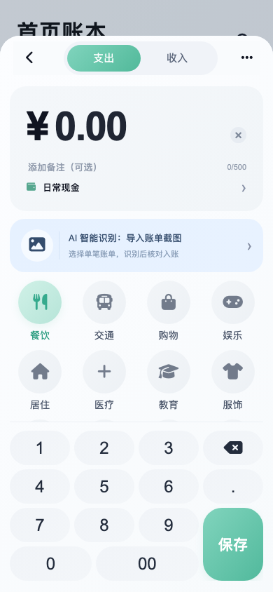 | 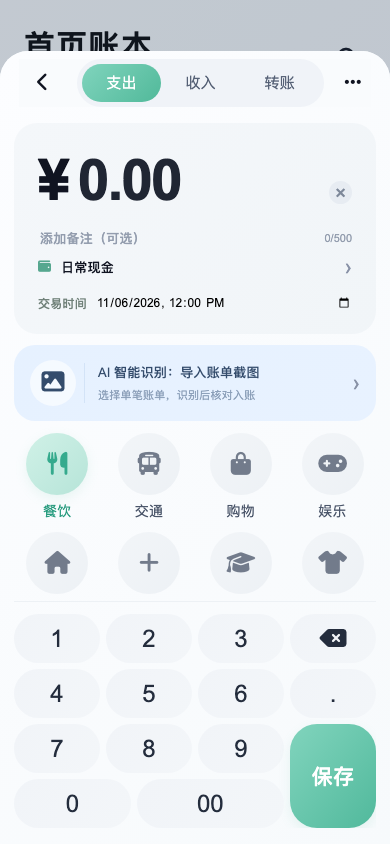 |
| 资产 | 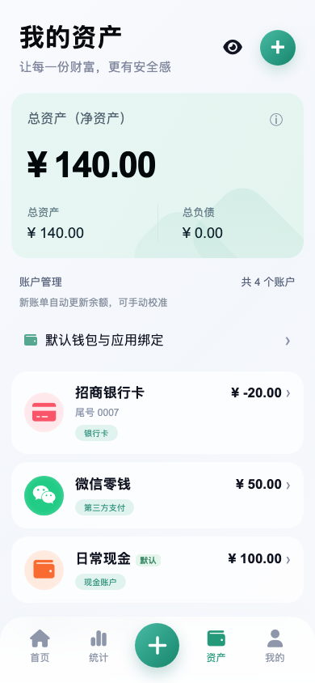 |  |
| 统计 | 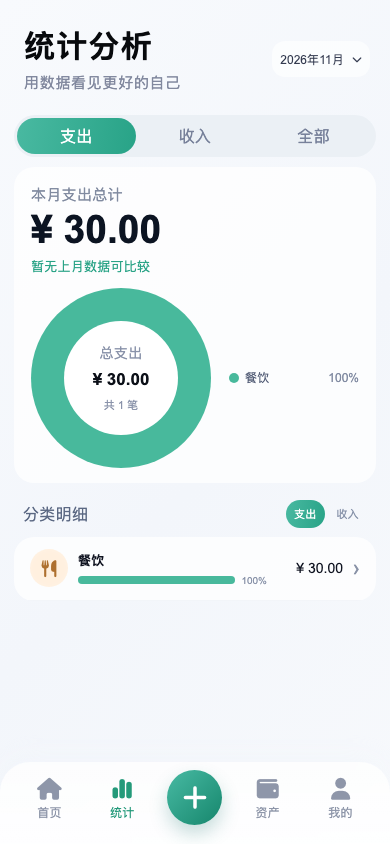 | 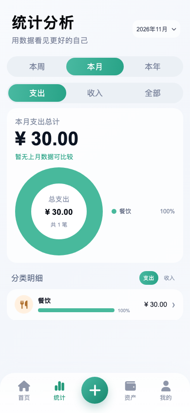 |

其余同状态对照：[首页前](ledger-before.png) / [后](ledger-after.png)、[账单文件入口前](bill-file-tools-before.png) / [后](bill-file-tools-after.png)、[截图导入前](image-import-before.png) / [后](image-import-after.png)。

| 本人互转表单 | 缺费待确认与人工补齐 | 年度精确金额 |
| --- | --- | --- |
| 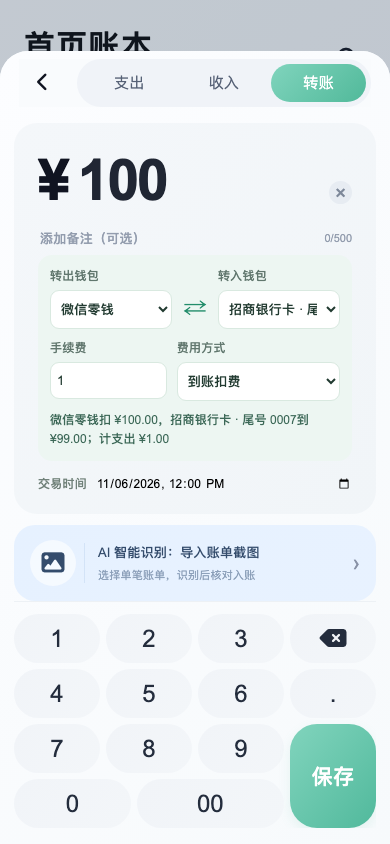 | 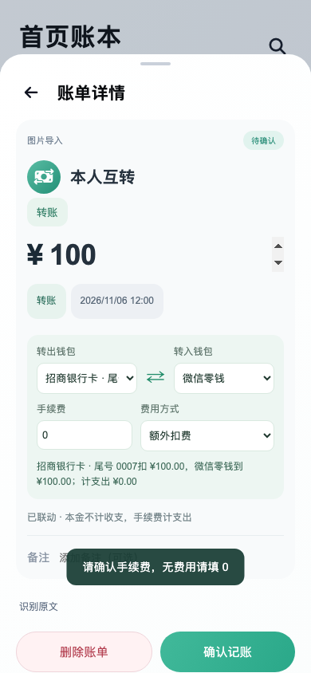 | 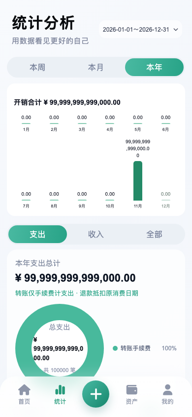 |

浏览器夹具只验证布局、表单和精确金额显示；真实数据库资金和 100000 笔公共统计另由 Android 用例验证，见 [S3 验收](../../ACCEPTANCE-TRANSFERS-S3.md)。

## Android 原生文件预览

以下四图来自 API30 arm64 模拟器 `emulator-5554` 上真实 `onActivityResult` 与 UiAutomation 操作，1080×2220；合成金额与原图哈希见 [native-metadata.json](native-metadata.json)。截图后取消预览，图片不代表实际提交，数据库提交另有文件迁移用例。

| 账单默认关闭联动，预计变化 0 | 明确开启并映射：A1000→899，B200→300 |
| --- | --- |
| 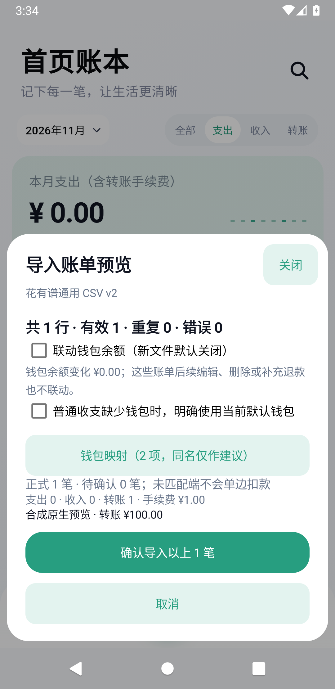 | 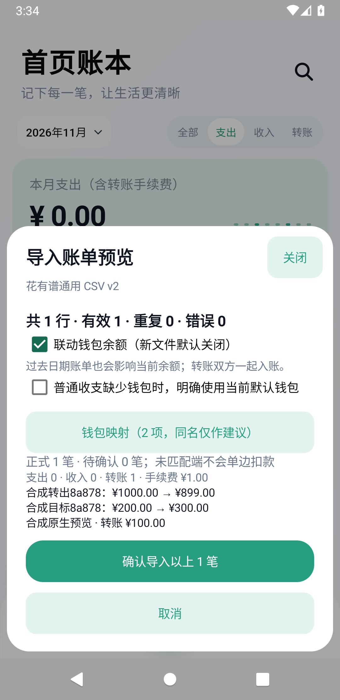 |

| 钱包默认保留本地 500 | 明确选择覆盖为文件 300 |
| --- | --- |
|  | 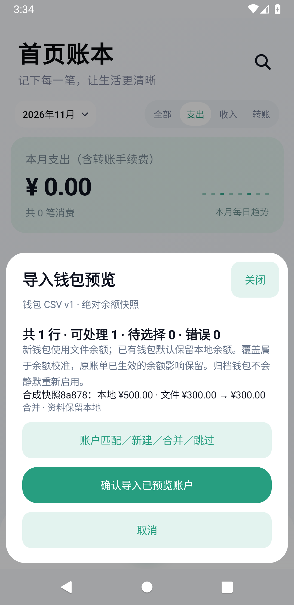 |

## 小组件与真实支付页面

用户已停止小组件工作，保留当前实现且未封验收；本轮不再补组件测试或截图。此目录不把旧网格、footer 或旧月柱图当作最终证据；既有过程图不能证明最终布局、字号、主题或 Launcher 兼容通过。

未取得真实微信/支付宝充值提现页面；本目录与外部支付 fixture 均为合成数据，不证明真实 App 全面兼容。

## 复跑

从 `91aad555` 建立独立只读基线 checkout，安装锁定 Playwright 后执行（`PLAYWRIGHT_MODULE` 可指向已有安装）：

```sh
node scripts/capture-transfer-baseline.cjs /absolute/path/to/baseline output/transfers-baseline
node scripts/check-transfers.cjs
python3 scripts/collect-transfer-screenshots.py
```

原生预览由 `net.ankio.ledger.NativeImportPreviewTest` 生成，测试截图先保存在 `/data/local/tmp/huayoupu-s5-*.png`，需从明确的隔离模拟器拉取；不操作个人手机或读取真实账单。最终源码版本与报告以[总验证记录](../../VERIFICATION-TRANSFERS-IMPORT-EXPORT-AND-WIDGET.md)为准。
